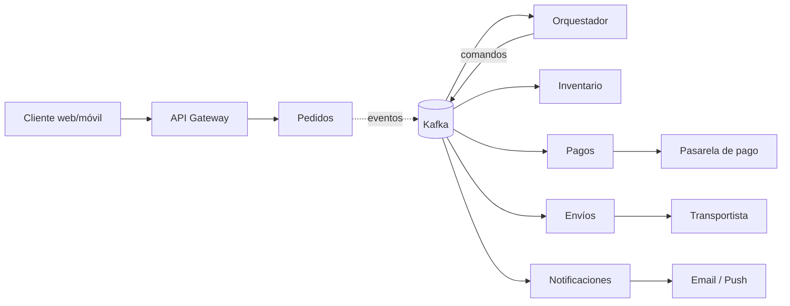
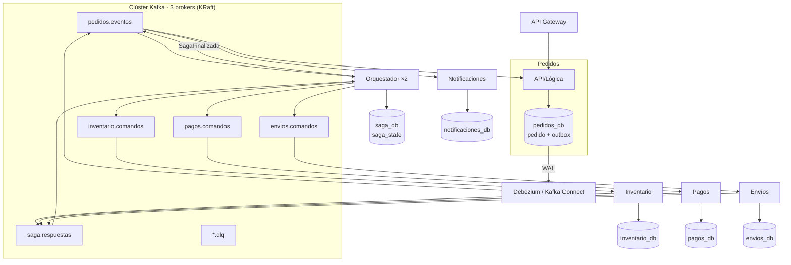
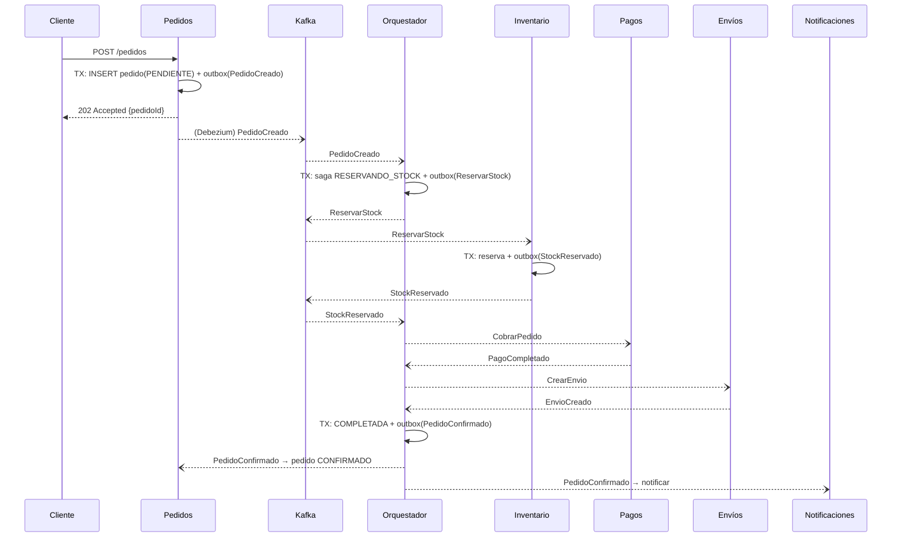
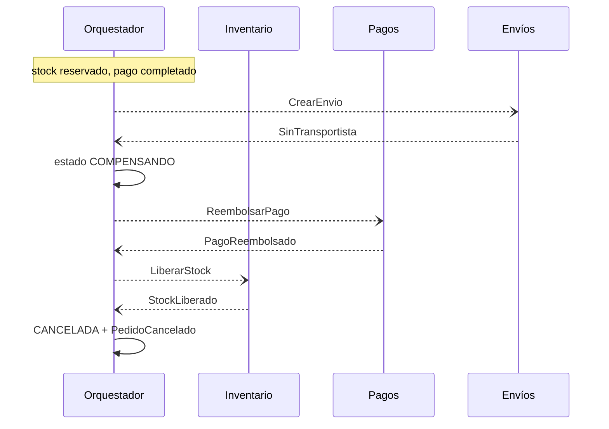
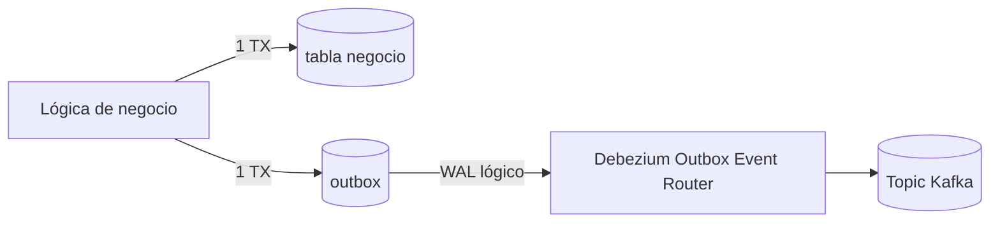
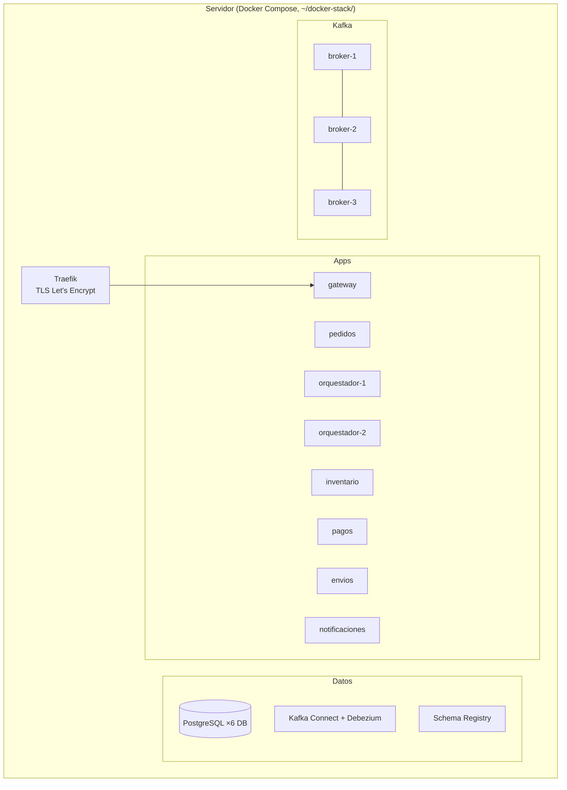

# Documento de Arquitectura — Pedidos con Kafka y PostgreSQL

Versión 1.0 · 2026-10-22 · Complementa `01-SRS.md` y `03-modelo-de-datos.md`

## 1. Resumen de decisiones (ADR)

| # | Decisión | Motivo | Alternativa descartada |
|---|---|---|---|
| ADR-1 | Saga **orquestada** | Muchos pasos, reglas claras, estado visible en un único lugar | Coreografía: flujo difuso al crecer |
| ADR-2 | **Transactional Outbox** + relay | Evita la doble escritura BD/Kafka | Publicar tras el commit (puede quedar a medias) |
| ADR-3 | Relay de la outbox. **Implementado: poller** (`SELECT … FOR UPDATE SKIP LOCKED`, cada 200 ms, en cada servicio). Debezium (CDC sobre el WAL) queda como evolución | El poller no añade piezas (Kafka Connect, replication slots) y basta para el volumen inicial | Debezium: menor latencia y sin polling, más operación |
| ADR-4 | **Database per service** en PostgreSQL | Autonomía y aislamiento de fallos | BD compartida: acoplamiento por esquema |
| ADR-5 | Kafka **KRaft** (≥ 4.0), 3 brokers | Sin ZooKeeper; tolera la caída de 1 broker escribiendo | Cola sencilla (RabbitMQ): sin log reproducible |
| ADR-6 | Clave de mensaje = `pedidoId` | Orden por pedido dentro de la partición | Sin clave: sin orden |
| ADR-7 | Avro/Protobuf + **Schema Registry** (objetivo). **Implementado: JSON** con campo `tipo` y cabeceras `messageId`/`sagaId` | Simplicidad inicial; añadir Schema Registry es la evolución prevista | — |
| ADR-8 | Idempotencia con tabla `processed_message` | *At-least-once* es lo que da Kafka | Confiar en *exactly-once* entre sistemas heterogéneos |

## 2. Vista de contexto



## 3. Vista de contenedores



Cada servicio con BD propia incluye también `outbox` y `processed_message` (ver modelo de datos). Debezium se despliega una vez por BD (conector con *outbox event router*).

### 3.1 Topics

| Topic | Productor | Consumidor | Clave | Contenido |
|---|---|---|---|---|
| `pedidos.eventos` | Pedidos (relay), Orquestador | Orquestador, Pedidos, Notificaciones | `pedidoId` | `PedidoCreado`, `PedidoConfirmado`, `PedidoCancelado` |
| `inventario.comandos` | Orquestador | Inventario | `pedidoId` | `ReservarStock`, `LiberarStock` |
| `pagos.comandos` | Orquestador | Pagos | `pedidoId` | `CobrarPedido`, `ReembolsarPago` |
| `envios.comandos` | Orquestador | Envíos | `pedidoId` | `CrearEnvio`, `CancelarEnvio` |
| `saga.respuestas` | Inventario, Pagos, Envíos | Orquestador | `pedidoId` | `StockReservado/Insuficiente/Liberado`, `PagoCompletado/Rechazado/Reembolsado`, `EnvioCreado/SinTransportista/Cancelado` |
| `<topic>.dlq` | Cualquier consumidor | Operación | original | Mensaje fallido + causa |

**Configuración común:** 6 particiones, `replication.factor=3`, `min.insync.replicas=2`, `retention.ms=7d`. Productores: `acks=all`, `enable.idempotence=true`. Consumidores: `enable.auto.commit=false`, `isolation.level=read_committed`.

### 3.2 Contrato de mensaje

Cabeceras Kafka: `messageId` (UUID), `sagaId`, `traceId`, `tipo`, `version`, `timestamp`.
Cuerpo (ejemplo `ReservarStock`):
```json
{ "sagaId": "…", "pedidoId": "…", "lineas": [{"productoId": "…", "cantidad": 2}] }
```
Los consumidores identifican duplicados con `messageId` (y, para negocio, con `(sagaId, paso)`).

## 4. Saga orquestada

### 4.1 Máquina de estados

```mermaid
stateDiagram-v2
    [*] --> INICIADA
    INICIADA --> RESERVANDO_STOCK: enviar ReservarStock
    RESERVANDO_STOCK --> COBRANDO: StockReservado
    RESERVANDO_STOCK --> CANCELADA: StockInsuficiente
    COBRANDO --> CREANDO_ENVIO: PagoCompletado
    COBRANDO --> COMPENSANDO: PagoRechazado
    CREANDO_ENVIO --> COMPLETADA: EnvioCreado
    CREANDO_ENVIO --> COMPENSANDO: SinTransportista
    COMPENSANDO --> CANCELADA: compensaciones OK
    COMPENSANDO --> FALLIDA_MANUAL: reintentos agotados (DLQ)
    COMPLETADA --> [*]
    CANCELADA --> [*]
    FALLIDA_MANUAL --> [*]
```



`COMPENSANDO` ejecuta, en orden inverso y solo para lo completado: `CancelarEnvio` (si existe) → `ReembolsarPago` (si hubo cobro) → `LiberarStock` (si hubo reserva). La lista de pasos completados se guarda en `saga_step`.

### 4.2 Secuencia — camino feliz



### 4.3 Secuencia — fallo en envío (compensación)



### 4.4 Comportamiento del orquestador
1. **Consumir** mensaje → comprobar `processed_message` (descarta duplicados).
2. **En una sola transacción**: actualizar `saga_state` (con `version` para bloqueo optimista), insertar `saga_step`, insertar el siguiente comando en `outbox`, registrar `processed_message`.
3. **Confirmar offset** tras el commit.
4. **Timeouts:** un job periódico busca sagas con `deadline_at < now()` y paso sin respuesta; reenvía el comando (mismo `messageId` de negocio) con *backoff* exponencial hasta `max_intentos`, y entonces pasa a `FALLIDA_MANUAL` + DLQ + alerta.
5. **Concurrencia:** varias réplicas comparten el grupo de consumidores; al ser la clave `pedidoId`, una saga la procesa una sola réplica a la vez; `version` protege durante rebalanceos.

## 5. Patrón Outbox y relay



- Una **única transacción** escribe el cambio y la fila de `outbox`.
- **Debezium** (conector `PostgresConnector` + `EventRouter`) lee el WAL (replication slot) y enruta por `aggregate_type` al topic; clave = `aggregate_id`.
- Puede haber **duplicados** (reinicio del conector) → consumidores idempotentes.
- Tras publicar, el relay no borra la fila: un job de limpieza purga por antigüedad (evita acoplar el borrado al WAL).
- **Plan B sin Debezium:** poller que ejecuta `SELECT … WHERE publicado_at IS NULL ORDER BY id FOR UPDATE SKIP LOCKED LIMIT n`, publica y marca `publicado_at`.
- Requisitos PostgreSQL: `wal_level=logical`, `max_replication_slots`, `max_wal_senders`; monitorizar el retraso del slot para que no crezca el WAL.

## 6. Idempotencia

| Capa | Mecanismo |
|---|---|
| API de pedidos | `Idempotency-Key` único por cliente → tabla `idempotency_key` |
| Consumidor genérico | `INSERT INTO processed_message(message_id) … ON CONFLICT DO NOTHING`; si no inserta fila → duplicado, se ignora. Se hace **en la misma TX que el efecto**. |
| Negocio | Restricciones únicas por `(saga_id, paso)` en reservas, cobros, envíos |
| Pasarela externa | Clave de idempotencia = `sagaId` + paso |

## 7. Vista de datos
PostgreSQL con una base de datos por servicio. Detalle completo y DDL en `03-modelo-de-datos.md`.

**Topología PostgreSQL recomendada**
- *Desarrollo / entorno pequeño:* una instancia con 6 bases de datos y un rol por servicio (aislamiento lógico).
- *Producción:* instancias separadas (o al menos separadas por dominio crítico: Pagos), con réplica de lectura/HA gestionada. Las BD en VM aparte, nunca con el servicio.

## 8. Despliegue



- Dominios `*.sslip.io` con TLS ACME vía Traefik; Gateway como único servicio expuesto.
- `cp` a `.bak` antes de editar compose; contraseñas generadas con `openssl rand` en el `.env` del host.
- Cada servicio: imagen propia, *healthcheck*, migraciones al arranque (Flyway), arranque ordenado (`depends_on` con condición de salud).
- Mínimo 3 brokers (quórum KRaft: 3 controllers combinados o dedicados).

## 9. Fiabilidad: análisis de fallos

| Fallo | Efecto | Mitigación |
|---|---|---|
| Cae un broker | Se elige nuevo líder entre el ISR; con `min.insync.replicas=2` se sigue escribiendo | Réplicas ×3, `acks=all` |
| Caen 2 brokers | Se puede leer, pero las particiones rechazan escrituras (no se arriesgan datos) | Outbox acumula; se publica al recuperar |
| Cae Pedidos tras el commit | El evento sigue en el outbox | Debezium lo publica; duplicado tolerado |
| Cae el orquestador | Sagas en pausa | Réplica toma las particiones; retoma desde `saga_state` |
| Cae un servicio de dominio | Comandos esperan en el topic | Al volver consume desde su offset; timeouts del orquestador reintentan |
| Duplicado de mensaje | — | `processed_message` + únicos de negocio |
| Mensaje venenoso | Bloquea la partición | Reintentos acotados → DLQ |
| Lag creciente | Latencia alta | Alertas; escalar consumidores hasta nº de particiones |
| Rebalanceo | Pausa breve | Offsets confirmados; idempotencia |

## 10. Seguridad
- Gateway: JWT/OIDC, rate limiting.
- Kafka: TLS + SASL/SCRAM (o mTLS); ACL: cada servicio solo `WRITE` en sus topics de salida y `READ` en los de entrada; grupo de consumidores nombrado por servicio.
- PostgreSQL: un rol por BD, `scram-sha-256`, TLS; el usuario de Debezium solo con `REPLICATION` y `SELECT` sobre `outbox`.
- Secretos fuera del repositorio; PII mínima en eventos.

## 11. Observabilidad
- **Trazas:** OpenTelemetry; `traceId` en cabeceras Kafka.
- **Logs estructurados** con `sagaId`, `pedidoId`, `messageId`.
- **Métricas clave:** consumer lag, under-replicated partitions, outbox pendiente (antigüedad), retraso del replication slot, sagas por estado, duración P50/P95, tamaño DLQ.
- **Dashboards:** Salud Kafka, Salud sagas, Outbox/CDC.

## 12. Evolución y riesgos

| Riesgo | Plan |
|---|---|
| Orquestador cuello de botella | Réplicas + más particiones; particionar por `pedidoId` |
| Crecimiento del WAL por slot parado | Alerta de retraso del slot; `max_slot_wal_keep_size` |
| Cambios de contrato | Schema Registry con compatibilidad; versionado en cabecera |
| Estados intermedios visibles | Pedido `PENDIENTE`→`CONFIRMADO`; UI muestra "en proceso" |
| Compensación imposible | Marcar `FALLIDA_MANUAL`, DLQ y procedimiento del operador |

## 13. Stack propuesto (ajustable)
Java 21 + Spring Boot 3 (Spring Kafka, Spring Data JPA/jOOQ, Flyway) — o Node.js/TypeScript (NestJS + KafkaJS) si se prefiere; la arquitectura no depende del lenguaje. Kafka 4.x KRaft, Confluent Schema Registry (o Apicurio), Debezium 2.x, PostgreSQL 16+, Traefik 3, OpenTelemetry + Prometheus/Grafana.
