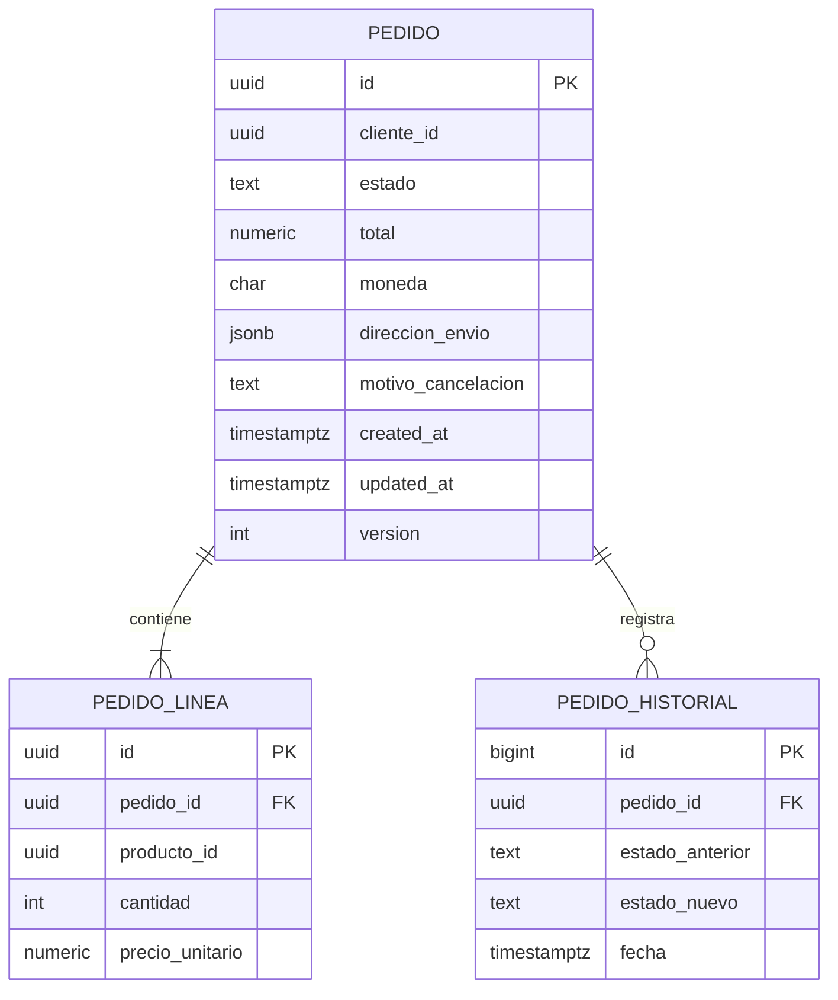
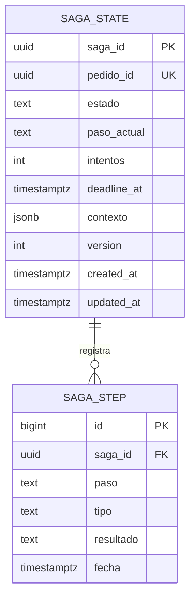
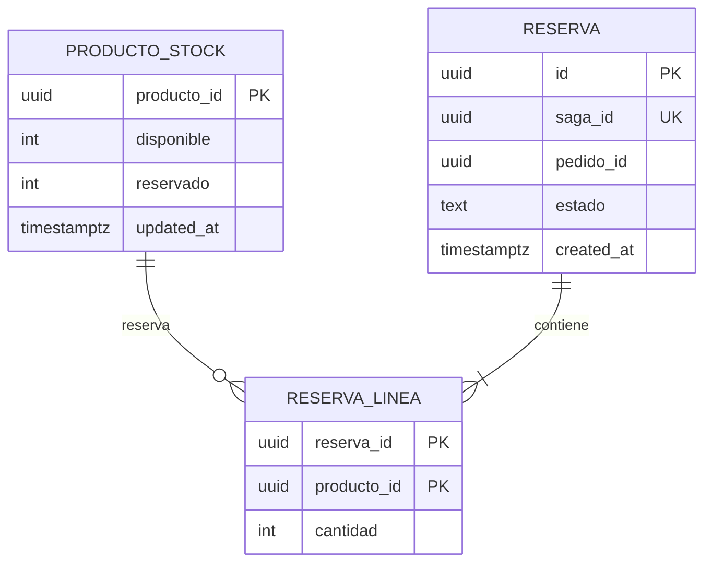
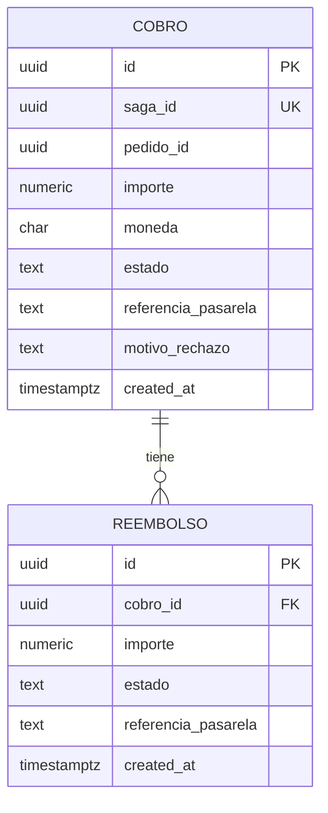
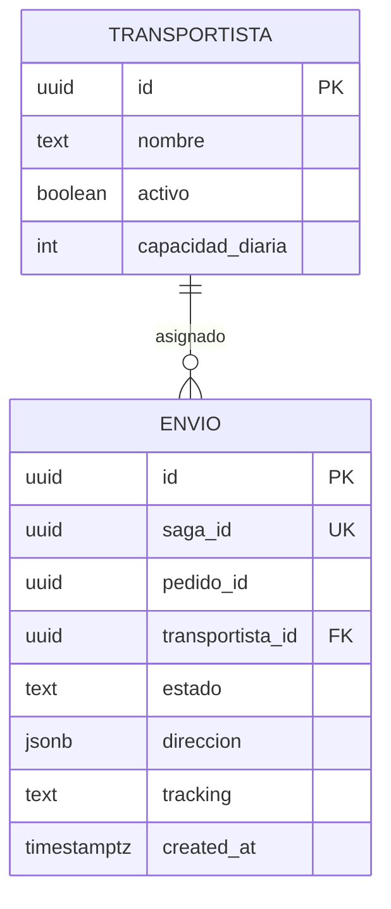

# Modelo de datos — PostgreSQL por microservicio

Versión 1.0 · 2026-10-22 · Complementa `01-SRS.md` y `02-arquitectura.md`

## 1. Principios
- **Una base de datos por servicio**; ningún servicio lee/escribe en la de otro. Sin FKs entre BD: las referencias (`pedido_id`, `saga_id`, `producto_id`) son identificadores lógicos.
- **UUID** (`uuid`, v7 si es posible para localidad de índice) como clave primaria en las entidades que viajan en mensajes. Se genera `gen_random_uuid()` (PG ≥ 13).
- Importes en `numeric(12,2)` + `moneda char(3)`; fechas en `timestamptz`.
- Estados como `text` con `CHECK` (más fácil de migrar que un `ENUM`).
- Todo servicio que publica tiene `outbox`; todo servicio que consume tiene `processed_message`.

## 2. Tablas comunes (en cada servicio)

```sql
-- Outbox: se inserta en la misma TX que el cambio de negocio
CREATE TABLE outbox (
    seq            bigint      GENERATED ALWAYS AS IDENTITY,   -- orden de publicación (created_at no distingue filas de una misma TX)
    id             uuid        PRIMARY KEY DEFAULT gen_random_uuid(),
    aggregate_type text        NOT NULL,            -- p.ej. 'pedido' → decide el topic en el router
    aggregate_id   text        NOT NULL,            -- clave Kafka (pedidoId)
    event_type     text        NOT NULL,            -- 'PedidoCreado', 'StockReservado', ...
    payload        jsonb       NOT NULL,
    headers        jsonb       NOT NULL DEFAULT '{}',   -- sagaId, traceId, version
    created_at     timestamptz NOT NULL DEFAULT now(),
    published_at   timestamptz                          -- solo si se usa poller en vez de CDC
);
CREATE UNIQUE INDEX outbox_seq_idx ON outbox (seq);
CREATE INDEX outbox_pendientes_idx ON outbox (seq) WHERE published_at IS NULL;

-- Idempotencia de consumidores
CREATE TABLE processed_message (
    message_id   uuid        PRIMARY KEY,
    consumer     text        NOT NULL,             -- nombre del grupo/handler
    processed_at timestamptz NOT NULL DEFAULT now()
);
CREATE INDEX processed_message_at_idx ON processed_message (processed_at);  -- para purga
```

Uso del consumidor:
```sql
INSERT INTO processed_message (message_id, consumer) VALUES ($1, $2)
ON CONFLICT DO NOTHING;   -- 0 filas afectadas ⇒ duplicado ⇒ ignorar
```

Purga periódica: `DELETE FROM outbox WHERE created_at < now() - interval '7 days';` y `processed_message` con un margen mayor que la retención del topic (p. ej. 14 días).

## 3. `pedidos_db` — servicio Pedidos



```sql
CREATE TABLE pedido (
    id                 uuid PRIMARY KEY DEFAULT gen_random_uuid(),
    cliente_id         uuid        NOT NULL,
    estado             text        NOT NULL DEFAULT 'PENDIENTE'
                       CHECK (estado IN ('PENDIENTE','CONFIRMADO','CANCELADO')),
    total              numeric(12,2) NOT NULL CHECK (total >= 0),
    moneda             char(3)     NOT NULL DEFAULT 'EUR',
    direccion_envio    jsonb       NOT NULL,
    motivo_cancelacion text,
    created_at         timestamptz NOT NULL DEFAULT now(),
    updated_at         timestamptz NOT NULL DEFAULT now(),
    version            int         NOT NULL DEFAULT 0
);
CREATE INDEX pedido_cliente_idx ON pedido (cliente_id, created_at DESC);
CREATE INDEX pedido_estado_idx  ON pedido (estado) WHERE estado = 'PENDIENTE';

CREATE TABLE pedido_linea (
    id              uuid PRIMARY KEY DEFAULT gen_random_uuid(),
    pedido_id       uuid          NOT NULL REFERENCES pedido(id) ON DELETE CASCADE,
    producto_id     uuid          NOT NULL,
    cantidad        int           NOT NULL CHECK (cantidad > 0),
    precio_unitario numeric(12,2) NOT NULL CHECK (precio_unitario >= 0),
    UNIQUE (pedido_id, producto_id)
);

CREATE TABLE pedido_historial (
    id              bigserial PRIMARY KEY,
    pedido_id       uuid        NOT NULL REFERENCES pedido(id) ON DELETE CASCADE,
    estado_anterior text,
    estado_nuevo    text        NOT NULL,
    fecha           timestamptz NOT NULL DEFAULT now()
);
CREATE INDEX pedido_historial_idx ON pedido_historial (pedido_id, fecha);

-- Idempotencia de la API (RF-04)
CREATE TABLE idempotency_key (
    cliente_id  uuid        NOT NULL,
    key         text        NOT NULL,
    pedido_id   uuid        NOT NULL,
    created_at  timestamptz NOT NULL DEFAULT now(),
    PRIMARY KEY (cliente_id, key)
);
-- + outbox y processed_message (§2)
```

**Transacción de creación (RF-02):**
```sql
BEGIN;
  INSERT INTO pedido (...) RETURNING id;
  INSERT INTO pedido_linea (...);
  INSERT INTO pedido_historial (pedido_id, estado_nuevo) VALUES (:id, 'PENDIENTE');
  INSERT INTO outbox (aggregate_type, aggregate_id, event_type, payload)
         VALUES ('pedido', :id::text, 'PedidoCreado', :payload);
COMMIT;
```

## 4. `saga_db` — Orquestador



```sql
CREATE TABLE saga_state (
    saga_id      uuid PRIMARY KEY,
    pedido_id    uuid        NOT NULL UNIQUE,      -- una saga por pedido (idempotencia de PedidoCreado)
    estado       text        NOT NULL CHECK (estado IN (
                   'INICIADA','RESERVANDO_STOCK','COBRANDO','CREANDO_ENVIO',
                   'COMPLETADA','COMPENSANDO','CANCELADA','FALLIDA_MANUAL')),
    paso_actual  text,                              -- paso/compensación en vuelo
    intentos     int         NOT NULL DEFAULT 0,
    deadline_at  timestamptz,                       -- vencimiento del paso en vuelo
    contexto     jsonb       NOT NULL DEFAULT '{}', -- líneas, importe, ids devueltos (reserva, cobro, envío)
    motivo_fallo text,
    version      int         NOT NULL DEFAULT 0,    -- bloqueo optimista
    created_at   timestamptz NOT NULL DEFAULT now(),
    updated_at   timestamptz NOT NULL DEFAULT now()
);
CREATE INDEX saga_vencidas_idx ON saga_state (deadline_at)
    WHERE estado NOT IN ('COMPLETADA','CANCELADA','FALLIDA_MANUAL');

CREATE TABLE saga_step (
    id        bigserial PRIMARY KEY,
    saga_id   uuid        NOT NULL REFERENCES saga_state(saga_id) ON DELETE CASCADE,
    paso      text        NOT NULL CHECK (paso IN ('RESERVAR_STOCK','COBRAR','CREAR_ENVIO')),
    tipo      text        NOT NULL CHECK (tipo IN ('ACCION','COMPENSACION')),
    resultado text        NOT NULL CHECK (resultado IN ('ENVIADO','OK','FALLO')),
    detalle   jsonb,
    fecha     timestamptz NOT NULL DEFAULT now()
);
CREATE INDEX saga_step_idx ON saga_step (saga_id, id);
-- + outbox y processed_message (§2)
```

La lista de pasos a compensar se calcula con `saga_step` (`tipo='ACCION' AND resultado='OK'` sin su compensación `OK`), en orden inverso por `id`.

**Actualización con bloqueo optimista:**
```sql
UPDATE saga_state
   SET estado = :nuevo, paso_actual = :paso, version = version + 1, updated_at = now()
 WHERE saga_id = :id AND version = :version;   -- 0 filas ⇒ conflicto ⇒ reintentar
```

## 5. `inventario_db` — Inventario



```sql
CREATE TABLE producto_stock (
    producto_id uuid PRIMARY KEY,
    nombre      text NOT NULL DEFAULT '',
    disponible  int NOT NULL CHECK (disponible >= 0),
    reservado   int NOT NULL DEFAULT 0 CHECK (reservado >= 0),
    updated_at  timestamptz NOT NULL DEFAULT now()
);

CREATE TABLE reserva (
    id         uuid PRIMARY KEY DEFAULT gen_random_uuid(),
    saga_id    uuid NOT NULL UNIQUE,              -- idempotencia de ReservarStock (RF-22)
    pedido_id  uuid NOT NULL,
    estado     text NOT NULL CHECK (estado IN ('RESERVADA','LIBERADA','RECHAZADA')),
    created_at timestamptz NOT NULL DEFAULT now(),
    updated_at timestamptz NOT NULL DEFAULT now()
);

CREATE TABLE reserva_linea (
    reserva_id  uuid NOT NULL REFERENCES reserva(id) ON DELETE CASCADE,
    producto_id uuid NOT NULL REFERENCES producto_stock(producto_id),
    cantidad    int  NOT NULL CHECK (cantidad > 0),
    PRIMARY KEY (reserva_id, producto_id)
);
-- + outbox y processed_message (§2)
```

**Reserva atómica (todo o nada), por línea y en orden de `producto_id` para evitar interbloqueos:**
```sql
UPDATE producto_stock
   SET disponible = disponible - :n, reservado = reservado + :n, updated_at = now()
 WHERE producto_id = :p AND disponible >= :n;      -- 0 filas ⇒ StockInsuficiente ⇒ ROLLBACK de la reserva
```
Liberación: `UPDATE reserva SET estado='LIBERADA' WHERE saga_id=:s AND estado='RESERVADA'`; solo si afecta 1 fila se devuelve el stock (idempotente).

## 6. `pagos_db` — Pagos



```sql
CREATE TABLE cobro (
    id                  uuid PRIMARY KEY DEFAULT gen_random_uuid(),
    saga_id             uuid NOT NULL UNIQUE,         -- un cobro por saga (RF-32)
    pedido_id           uuid NOT NULL,
    importe             numeric(12,2) NOT NULL CHECK (importe > 0),
    moneda              char(3) NOT NULL,
    estado              text NOT NULL CHECK (estado IN ('PENDIENTE','COMPLETADO','RECHAZADO','REEMBOLSADO')),
    referencia_pasarela text,
    motivo_rechazo      text,
    created_at          timestamptz NOT NULL DEFAULT now(),
    updated_at          timestamptz NOT NULL DEFAULT now()
);

CREATE TABLE reembolso (
    id                  uuid PRIMARY KEY DEFAULT gen_random_uuid(),
    cobro_id            uuid NOT NULL UNIQUE REFERENCES cobro(id),  -- un reembolso total por cobro
    importe             numeric(12,2) NOT NULL CHECK (importe > 0),
    estado              text NOT NULL CHECK (estado IN ('PENDIENTE','COMPLETADO','FALLIDO')),
    referencia_pasarela text,
    created_at          timestamptz NOT NULL DEFAULT now()
);
-- + outbox y processed_message (§2)
```
Cobro y reembolso permanecen ambos registrados (RF-31); el cobro pasa a `REEMBOLSADO` sin borrarse.
No se almacenan datos de tarjeta, solo la referencia/token de la pasarela.

## 7. `envios_db` — Envíos



```sql
CREATE TABLE transportista (
    id               uuid PRIMARY KEY DEFAULT gen_random_uuid(),
    nombre           text    NOT NULL,
    activo           boolean NOT NULL DEFAULT true,
    capacidad_diaria int     NOT NULL CHECK (capacidad_diaria >= 0),
    paises           text[]  NOT NULL DEFAULT '{ES}'            -- países que cubre
);

CREATE TABLE envio (
    id               uuid PRIMARY KEY DEFAULT gen_random_uuid(),
    saga_id          uuid NOT NULL UNIQUE,            -- idempotencia de CrearEnvio
    pedido_id        uuid NOT NULL,
    transportista_id uuid REFERENCES transportista(id),
    estado           text NOT NULL CHECK (estado IN ('CREADO','CANCELADO','SIN_TRANSPORTISTA')),
    direccion        jsonb NOT NULL,
    tracking         text,
    created_at       timestamptz NOT NULL DEFAULT now(),
    updated_at       timestamptz NOT NULL DEFAULT now()
);
CREATE INDEX envio_pedido_idx ON envio (pedido_id);
-- + outbox y processed_message (§2)
```

## 8. `notificaciones_db` — Notificaciones

```sql
CREATE TABLE notificacion (
    id          uuid PRIMARY KEY DEFAULT gen_random_uuid(),
    pedido_id   uuid        NOT NULL,
    cliente_id  uuid        NOT NULL,
    tipo        text        NOT NULL CHECK (tipo IN ('PEDIDO_CONFIRMADO','PEDIDO_CANCELADO')),
    canal       text        NOT NULL CHECK (canal IN ('EMAIL','PUSH')),
    estado      text        NOT NULL CHECK (estado IN ('PENDIENTE','ENVIADA','FALLIDA')),
    intentos    int         NOT NULL DEFAULT 0,
    created_at  timestamptz NOT NULL DEFAULT now(),
    enviada_at  timestamptz,
    UNIQUE (pedido_id, tipo, canal)                    -- RF-51: sin duplicados
);
-- + processed_message (§2); no publica eventos ⇒ no necesita outbox
```
El destinatario (email/token push) se resuelve en el momento del envío desde un servicio de clientes o una copia mínima local; no viaja en los eventos (RNF-24).

## 9. Resumen de identificadores y unicidad (idempotencia de negocio)

| Servicio | Restricción | Protege frente a |
|---|---|---|
| Pedidos | `idempotency_key(cliente_id, key)` | Doble envío del formulario |
| Orquestador | `saga_state.pedido_id UNIQUE` | `PedidoCreado` duplicado |
| Inventario | `reserva.saga_id UNIQUE` | Doble reserva |
| Pagos | `cobro.saga_id UNIQUE`, `reembolso.cobro_id UNIQUE` | Doble cobro / doble reembolso |
| Envíos | `envio.saga_id UNIQUE` | Doble envío |
| Notificaciones | `UNIQUE (pedido_id, tipo, canal)` | Doble email |
| Todos | `processed_message.message_id` | Cualquier duplicado de Kafka |

## 10. Operación de las bases de datos

- **Migraciones:** Flyway/Liquibase por servicio (`V1__init.sql`, …); compatibles hacia atrás (expand/contract).
- **Roles:** `<servicio>_app` (DML), `<servicio>_migrator` (DDL); `debezium` con `REPLICATION` + `SELECT` en `outbox`.
- **Publicación Debezium:** `CREATE PUBLICATION dbz_outbox FOR TABLE outbox;` y *replication slot* por conector.
- **Parámetros PostgreSQL:** `wal_level=logical`, `max_replication_slots ≥ nº conectores + margen`, `max_slot_wal_keep_size` acotado.
- **Backups:** `pg_dump`/PITR diario por BD; Pagos con RPO más estricto.
- **Mantenimiento:** purga programada de `outbox` y `processed_message` (§2); `autovacuum` ajustado en tablas de alta rotación (`outbox`, `processed_message`, `saga_state`).
- **Crecimiento:** `pedido_historial`, `saga_step` y `outbox` candidatos a particionado por fecha si el volumen lo exige.
